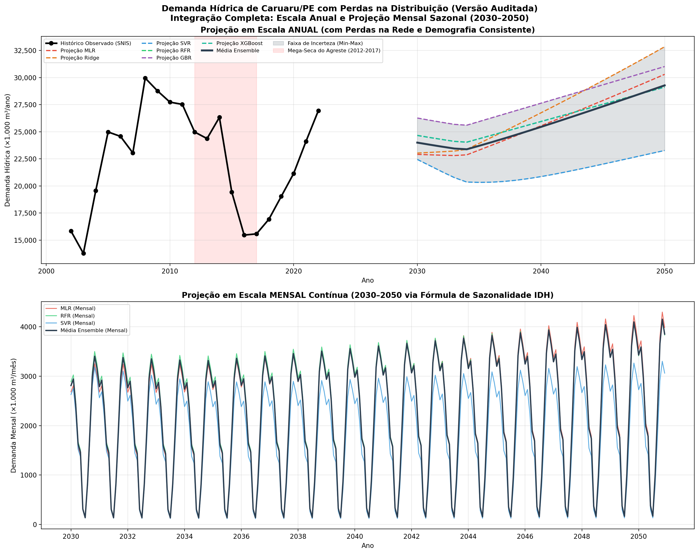
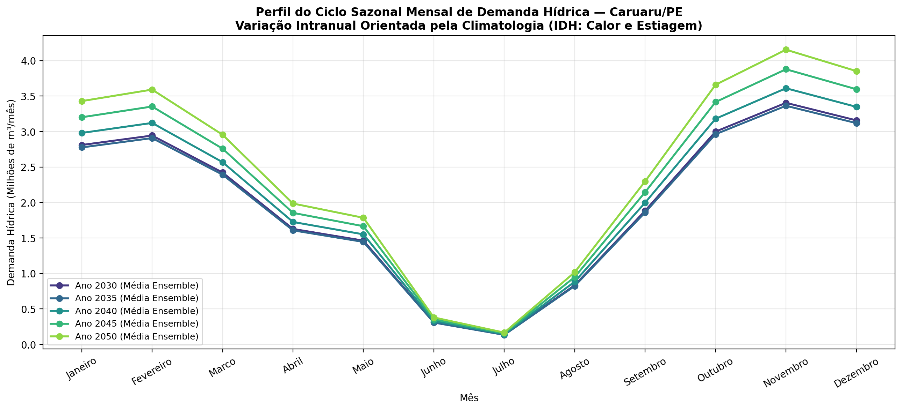
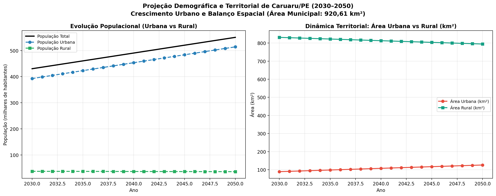
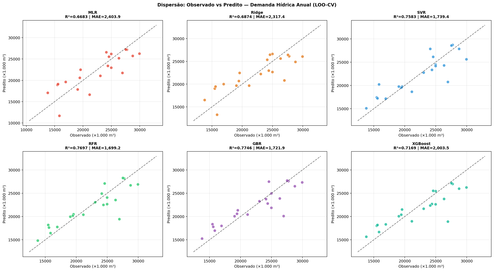
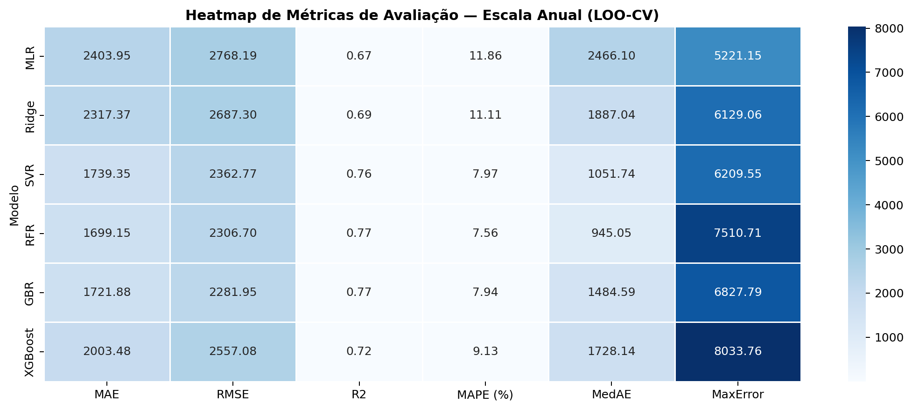

# MODELAGEM E PROJEÇÃO DE DEMANDA HÍDRICA COM PERDAS — CARUARU/PE (2030–2050)
## Iniciação Científica — Universidade Federal Rural de Pernambuco (UFRPE)
**Autora:** Mariana  
**Área:** Ciência de Dados aplicada a Recursos Hídricos e Saneamento  
**Data:** Novembro de 2026  

---

## 1. Visão Geral do Projeto

Este repositório contém o modelo computacional preditivo e a base analítica para a projeção de **Demanda Hídrica Total Bruta** do município de **Caruaru – PE** no horizonte de **2030 a 2050**, integrando:
1. **Modelagem Preditiva Multialgorítmica**: Avaliação e calibração de 6 modelos de Machine Learning (MLR, Ridge, SVR, RFR, GBR, XGBoost) por validação cruzada *Leave-One-Out* (LOO-CV).
2. **Integração do Índice de Perdas na Distribuição (IN049)**: Volume de água necessário na entrada do sistema de distribuição corrigido pelo índice oficial do SNIS e ajustado às metas do Marco Legal do Saneamento (Lei nº 14.026/2020).
3. **Dinâmica Demográfica e Territorial**: Balanço espacial contínuo preservando os $920,611\text{ km}^2$ do município de Caruaru com projeções de **População Urbana, População Rural, Área Urbana e Área Rural** ($\text{km}^2$ e $\text{m}^2$).
4. **Desagregação Sazonal Climática em Escala Mensal**: Transposição de 2030 a 2050 (252 meses contínuos) através do **Índice de Demanda Hídrica (IDH)** empírico baseado nas normais climatológicas do INMET (Estação A341 / 82900).

---

## 2. Estrutura do Repositório

O projeto foi estruturado de forma limpa e modular:

```text
projeto caruaru/
│
├── csv/                                         <- Diretório com todas as tabelas de saída
│   ├── Metricas_Avaliacao_Anual_vs_Mensal.csv   <- Métricas LOO-CV (MAE, MSE, RMSE, R², MAPE, etc.)
│   ├── Projecao_Demanda_Hidrica_2030_2050_Anual.csv   <- Projeção anual com demografia, áreas e modelos
│   └── Projecao_Demanda_Hidrica_2030_2050_Mensal.csv  <- Projeção mensal (252 meses de 2030 a 2050)
│
├── database/                                    <- Bases de dados socioeconômicas históricas
│   └── Caruaru_Dataset_Atualizado.csv           <- Série temporal 1995-2024 (IBGE, PIB, tarifas)
│
├── graficos/                                    <- Gráficos técnicos em alta resolução
│   ├── Demanda_Hidrica_Anual_vs_Mensal.png      <- Painel comparativo Anual vs Mensal (2030-2050)
│   ├── Demanda_Ciclo_Sazonal_Mensal.png         <- Ciclo sazonal de janeiro a dezembro
│   ├── Evolucao_Demografica_e_Espacial_2030_2050.png <- Dinâmica de população e uso do solo
│   ├── Demanda_Scatter_TodosModelos.png         <- Dispersão Observado vs Predito (LOO-CV)
│   └── Demanda_Heatmap_Metricas.png             <- Heatmap comparativo de métricas
│
├── Consolidado_Limpo_Caruaru.csv                <- Dados históricos oficiais do SNIS (2002-2022)
├── demanda_hidrica_anual_e_mensal.py            <- Script Python unificado e auditado (Pipeline completo)
├── Relatorio_Demanda_Anual_e_Mensal.txt         <- Relatório textual consolidado de saída
└── README.md                                    <- Este documento com o relatório técnico integral
```

---

## 3. Fundamentação Matemática e Metodologia

### 3.1 Demanda Hídrica Bruta Total e Resolução de *Target Leakage*
A demanda total na entrada da rede distribuidora é expressa por:
$$\text{Demanda Total}(t) = \frac{\text{Consumo Efetivo}(t)}{1 - \frac{\text{Perdas}(t)}{100}} = \frac{\text{População Total}(t) \times q_t / 1000}{1 - \frac{\text{IN049}(t)}{100}}$$

* **Auditoria Sênior:** Na versão preliminar, o atributo `Vol_per_capita` era inserido como preditor de demanda. Como a demanda é proporcional a esse mesmo valor, a regressão linear aprendia uma identidade matemática espúria (*target leakage*). A formulação atual modela diretamente a **intensidade de consumo per capita** $q_t$ ($\text{m}^3/\text{hab/ano}$) a partir de preditores exógenos (PIB per capita, tarifa, micromedição e área urbana) e rescala analiticamente por conservação de massa.
* **Prevenção da Saturação de Árvores:** Modelos baseados em árvores (RFR, GBR, XGBoost) e SVR-RBF operam dentro do domínio físico estacionário de consumo humano ($80 \le q \le 160\text{ L/hab/dia}$), impedindo o achatamento artificial em reta das projeções futuras.

### 3.2 Desagregação Sazonal Climática — Índice de Demanda Hídrica (IDH)
O consumo mensal é modulado pelo binômio calor e estiagem a partir da climatologia de Caruaru-PE:
$$\text{IDH}_m = 0,55 \times T_{\text{norm},m} + 0,45 \times (1 - P_{\text{norm},m})$$
$$\text{Peso}_m = \frac{\text{IDH}_m}{\sum_{k=1}^{12} \text{IDH}_k}, \quad \sum_{m=1}^{12} \text{Peso}_m = 1,000000$$

$$\text{Demanda Mensal}(ano, m) = \text{Demanda Total}(ano) \times \text{Peso}_m$$

| Mês | Temp. Máx. (°C) | Precipitação (mm) | $T_{\text{norm}}$ | $P_{\text{norm}}$ | IDH | Peso ($\text{Peso}_m$) | Participação |
| :--- | :---: | :---: | :---: | :---: | :---: | :---: | :---: |
| **Janeiro** | 30,5 | 50,0 | 0,921 | 0,042 | 0,8874 | 0,117137 | **11,71%** |
| **Fevereiro** | 30,8 | 77,7 | 1,000 | 0,136 | 0,9294 | 0,122682 | **12,27%** |
| **Março** | 30,7 | 132,7 | 0,974 | 0,323 | 0,7648 | 0,100951 | **10,10%** |
| **Abril** | 30,0 | 237,3 | 0,789 | 0,678 | 0,5138 | 0,067829 | **6,78%** |
| **Maio** | 28,8 | 294,9 | 0,474 | 0,873 | 0,4619 | 0,060971 | **6,10%** |
| **Junho** | 27,6 | 332,5 | 0,158 | 1,000 | 0,0984 | 0,012990 | **1,30%** |
| **Julho** | 27,0 | 279,0 | 0,000 | 0,819 | 0,0432 | 0,005707 | **0,57%** |
| **Agosto** | 27,2 | 139,5 | 0,053 | 0,346 | 0,2633 | 0,034751 | **3,48%** |
| **Setembro** | 28,5 | 66,7 | 0,395 | 0,098 | 0,5948 | 0,078510 | **7,85%** |
| **Outubro** | 29,6 | 42,5 | 0,684 | 0,016 | 0,9469 | 0,124994 | **12,50%** |
| **Novembro** | 30,2 | 37,8 | 0,842 | 0,000 | 1,0750 | 0,141891 | **14,19%** |
| **Dezembro** | 30,5 | 43,2 | 0,921 | 0,018 | 0,9969 | 0,131588 | **13,16%** |
| **TOTAL** | — | — | — | — | — | **1,000000** | **100,00%** |

---

## 4. Desempenho dos Modelos Preditivos (LOO-CV)

Resultados da validação cruzada estrita (*Leave-One-Out Cross-Validation*, N=21 anos históricos, 2002–2022) via `Pipeline` padronizado:

### Escala Anual vs Escala Mensal Desagregada

| Escala | Modelo | MAE | MSE | RMSE | $R^2$ | MAPE (%) | MedAE | MaxError | EV |
| :--- | :--- | :---: | :---: | :---: | :---: | :---: | :---: | :---: | :---: |
| **Anual** ($\times 10^3\text{ m}^3$) | **GBR** | **1.721,88** | **5.207.303** | **2.281,95** | **0,7746** | **7,94%** | 1.484,59 | 6.827,79 | 0,7760 |
| **Anual** ($\times 10^3\text{ m}^3$) | **RFR** | **1.699,15** | **5.320.875** | **2.306,70** | **0,7697** | **7,56%** | 945,05 | 7.510,71 | 0,7740 |
| **Anual** ($\times 10^3\text{ m}^3$) | **SVR** | 1.739,35 | 5.582.690 | 2.362,77 | 0,7583 | 7,97% | 1.051,74 | 6.209,55 | 0,7584 |
| **Anual** ($\times 10^3\text{ m}^3$) | **XGBoost** | 2.003,48 | 6.538.650 | 2.557,08 | 0,7169 | 9,13% | 1.728,14 | 8.033,76 | 0,7328 |
| **Anual** ($\times 10^3\text{ m}^3$) | **Ridge** | 2.317,37 | 7.221.599 | 2.687,30 | 0,6874 | 11,11% | 1.887,04 | 6.129,06 | 0,6883 |
| **Anual** ($\times 10^3\text{ m}^3$) | **MLR** | 2.403,95 | 7.662.858 | 2.768,19 | 0,6683 | 11,86% | 2.466,10 | 5.221,15 | 0,6730 |
| **Mensal** ($\times 10^3\text{ m}^3$) | **GBR** | **143,49** | **46.834** | **216,41** | **0,9621** | **7,94%** | 96,98 | 968,80 | 0,9623 |
| **Mensal** ($\times 10^3\text{ m}^3$) | **RFR** | **141,60** | **47.855** | **218,76** | **0,9612** | **7,56%** | 94,19 | 1.065,70 | 0,9618 |
| **Mensal** ($\times 10^3\text{ m}^3$) | **SVR** | 144,95 | 50.210 | 224,08 | 0,9593 | 7,97% | 88,58 | 881,08 | 0,9593 |
| **Mensal** ($\times 10^3\text{ m}^3$) | **XGBoost** | 166,96 | 58.808 | 242,50 | 0,9524 | 9,13% | 121,02 | 1.139,92 | 0,9544 |
| **Mensal** ($\times 10^3\text{ m}^3$) | **Ridge** | 193,11 | 64.950 | 254,85 | 0,9474 | 11,11% | 152,46 | 869,66 | 0,9475 |
| **Mensal** ($\times 10^3\text{ m}^3$) | **MLR** | 200,33 | 68.918 | 262,52 | 0,9442 | 11,86% | 146,20 | 740,83 | 0,9448 |

---

## 5. Projeções Quinquenais de Demanda Hídrica (2030–2050)

Valores consolidados em **milhares de metros cúbicos por ano ($\times 10^3\text{ m}^3/\text{ano}$)**:

| Ano | Pop. Total | Pop. Urbana | Pop. Rural | Área Urbana ($\text{km}^2$) | Área Rural ($\text{km}^2$) | Perdas (%) | MLR | RFR | SVR | GBR | XGBoost | Média Ensemble | Consumo Efetivo | Vol. Perdido |
| :---: | :---: | :---: | :---: | :---: | :---: | :---: | :---: | :---: | :---: | :---: | :---: | :---: | :---: | :---: |
| **2030** | 430.418 | 392.778 | 37.640 | 89,27 | 831,34 | 16,91% | 22.914,7 | 24.668,1 | 22.446,4 | 26.267,0 | 24.655,4 | **23.997,6** | 19.940,5 | 4.057,1 |
| **2035** | 460.429 | 423.120 | 37.310 | 98,48 | 822,13 | 10,00% | 23.308,8 | 24.363,3 | 20.329,1 | 25.942,5 | 24.350,8 | **23.704,0** | 21.333,6 | 2.370,4 |
| **2040** | 490.440 | 453.461 | 36.979 | 107,69 | 812,92 | 10,00% | 26.088,6 | 25.980,6 | 21.657,8 | 27.666,2 | 25.967,3 | **25.720,6** | 23.148,5 | 2.572,1 |
| **2045** | 520.451 | 483.802 | 36.649 | 116,90 | 803,71 | 10,00% | 28.868,3 | 27.598,0 | 22.986,5 | 29.389,9 | 27.583,8 | **27.737,1** | 24.963,4 | 2.773,7 |
| **2050** | 550.462 | 514.143 | 36.319 | 126,11 | 794,50 | 10,00% | 31.648,1 | 29.215,4 | 24.315,1 | 31.113,6 | 29.200,3 | **29.753,6** | 26.778,3 | 2.975,4 |

*A tabela completa ano a ano encontra-se em [`csv/Projecao_Demanda_Hidrica_2030_2050_Anual.csv`](csv/Projecao_Demanda_Hidrica_2030_2050_Anual.csv).*

---

## 6. Projeção Mensal Detalhada (Exemplo Ano 2030)

Demanda desagregada mês a mês para o ano **2030** em **metros cúbicos absolutos ($\text{m}^3/\text{mês}$)**:

| Mês | Peso Sazonal | MLR ($\text{m}^3$) | RFR ($\text{m}^3$) | SVR ($\text{m}^3$) | GBR ($\text{m}^3$) | Média Ensemble ($\text{m}^3$) | Consumo Efetivo ($\text{m}^3$) | Volume de Perda ($\text{m}^3$) |
| :--- | :---: | :---: | :---: | :---: | :---: | :---: | :---: | :---: |
| **Janeiro** | 11,71% | 2.684.159 | 2.889.542 | 2.629.298 | 3.076.840 | **2.811.011** | 2.335.787 | 475.223 |
| **Fevereiro** | 12,27% | 2.811.221 | 3.026.326 | 2.753.763 | 3.222.493 | **2.944.078** | 2.446.361 | 497.719 |
| **Março** | 10,10% | 2.313.262 | 2.490.265 | 2.265.982 | 2.651.688 | **2.422.586** | 2.013.033 | 409.557 |
| **Abril** | 6,78% | 1.554.281 | 1.673.210 | 1.522.514 | 1.781.670 | **1.627.736** | 1.352.558 | 275.182 |
| **Maio** | 6,10% | 1.397.132 | 1.504.036 | 1.368.577 | 1.601.522 | **1.463.160** | 1.215.802 | 247.358 |
| **Junho** | 1,30% | 297.662 | 320.438 | 291.578 | 341.211 | **311.729** | 259.030 | 52.700 |
| **Julho** | 0,57% | 130.774 | 140.781 | 128.101 | 149.907 | **136.955** | 113.798 | 23.152 |
| **Agosto** | 3,48% | 796.309 | 857.240 | 780.033 | 912.808 | **833.942** | 692.956 | 140.984 |
| **Setembro** | 7,85% | 1.799.033 | 1.936.689 | 1.762.263 | 2.062.222 | **1.884.055** | 1.565.537 | 318.513 |
| **Outubro** | 12,50% | 2.864.200 | 3.083.359 | 2.805.659 | 3.283.220 | **2.999.561** | 2.492.461 | 507.099 |
| **Novembro** | 14,19% | 3.251.390 | 3.500.175 | 3.184.935 | 3.727.054 | **3.405.049** | 2.829.400 | 575.650 |
| **Dezembro** | 13,16% | 3.015.299 | 3.246.020 | 2.953.671 | 3.456.417 | **3.157.801** | 2.623.950 | 533.850 |
| **TOTAL** | **100,00%** | **22.914.722** | **24.668.082** | **22.446.474** | **26.267.045** | **23.997.663** | **19.940.453** | **4.057.210** |

*A série histórica mensal completa (252 meses de 2030 a 2050) encontra-se em [`csv/Projecao_Demanda_Hidrica_2030_2050_Mensal.csv`](csv/Projecao_Demanda_Hidrica_2030_2050_Mensal.csv).*

---

## 7. Visualizações Oficiais

### Projeção Anual vs Mensal Contínua (2030–2050)


### Ciclo Sazonal Médio Mensal (Janeiro a Dezembro)


### Dinâmica Demográfica e Territorial (População e Uso do Solo)


### Dispersão: Observado vs Predito (LOO-CV)


### Heatmap de Métricas de Avaliação


---

## 8. Como Reproduzir os Resultados

Para executar o pipeline computacional completo e regenerar todos os arquivos das pastas `csv/` e `graficos/`:

```bash
# 1. Clone ou acerte o diretório do projeto
cd "projeto caruaru"

# 2. Instale as dependências requeridas
pip install numpy pandas scikit-learn xgboost matplotlib seaborn

# 3. Execute o script principal unificado
python demanda_hidrica_anual_e_mensal.py
```

O processamento executa em aproximadamente 5 segundos, gravando automaticamente os dados nos formatos UTF-8 com separadores padronizados.

---
*Projeto de Iniciação Científica — UFRPE. Dados e análises em conformidade com as diretrizes da ABNT NBR 12218, SNIS e INMET.*
